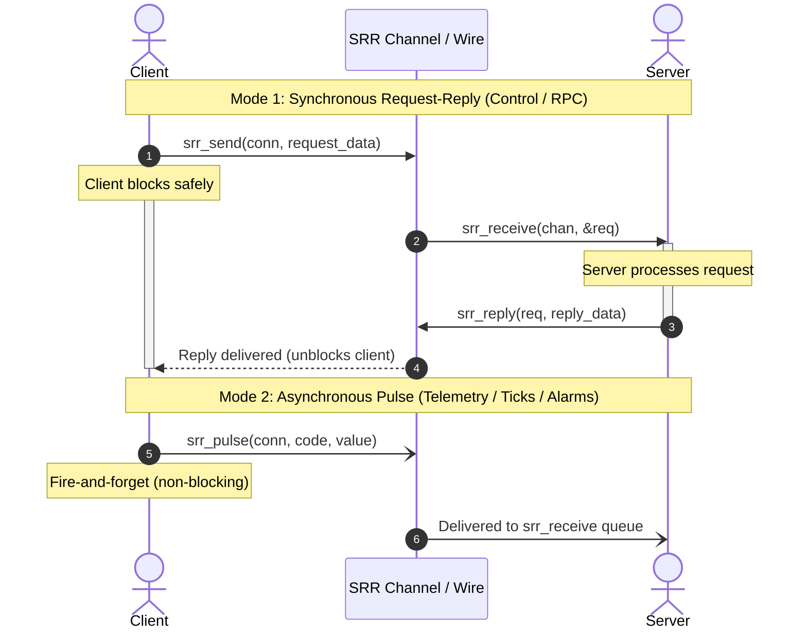

# SRR: Synchronous Message Passing for Portable Concurrent Systems

> **The missing interaction primitive for systems developers:** The exact same Send / Receive / Reply model whether you are passing commands across threads, local OS processes, or a serial wire to an 8-bit microcontroller.

---

## Why SRR? The Problem with Standard IPC

Every systems engineer eventually encounters the same fragmented nightmare when building real-world concurrent or embedded systems:

1. **Raw OS IPC (Unix Sockets, Pipes, FIFOs) is low-level and brittle:**
   - They are **unframed byte streams**. You must write manual length-prefix framing, delimiter parsing, and partial `read()`/`write()` loops just to get a message through safely.
   - They have **no built-in request/reply correlation**. If multiple threads or requests share a descriptor, responses get interleaved.
   - **Timeout races cause silent data corruption:** If your client times out waiting for a reply, the server's delayed response stays in the socket buffer. Your next request's `read()` receives the *stale reply from the previous transaction*.
   - Windows Named Pipes and Unix Sockets share zero API commonality, forcing dual implementations for cross-platform software.

2. **Heavyweight RPC (gRPC, ZeroMQ, MQTT) cannot go where you need them:**
   - **gRPC** requires HTTP/2, C++, OpenSSL, and megabytes of runtime footprint. It cannot run on microcontrollers like an RP2040 Pico or an ESP32, let alone an 8-bit AVR with 2 KB of total RAM.
   - **ZeroMQ** is fast on Linux, but its REQ/REP state machine notoriously locks into unrecoverable EFSM states if you send out-of-order, relies on dynamic heap allocation, and has zero bare-metal embedded support.
   - **MQTT / Message Brokers** require running an external daemon and add 10–50 ms of network broker hops to tasks that should take microseconds.

3. **Microcontrollers are forced into custom ad-hoc protocols:**
   - Every microcontroller project invents its own fragile binary packet structure over UART or SPI. Host software then needs custom parsers, separate timeout handling, and brittle glue code.

---

## The SRR Solution: One Contract from Threads to Silicon

Inspired by the proven microkernel message-passing architecture of QNX, SRR modernizes Send / Receive / Reply into a standalone, portable C99 library:

* **Symmetric Mental Model:** Call `srr_send()` from a C thread, a Python script, or an Erlang actor; answer with `srr_reply()` from a background Linux daemon or a cooperative loop on an Arduino. The semantics, framing, and error codes are identical.
* **Deterministic Single-Winner State Machine:** A transaction completes exactly once. If a timeout fires, any subsequent late reply is discarded cleanly—it will never corrupt future transactions. Disconnections immediately unblock pending callers without deadlocks.
* **Zero Heap on Bare Metal:** The embedded profiles operate entirely on statically allocated memory buffers. The AVR profile requires just **335 bytes of RAM** and **1.8 KB of code**, running directly on an ATmega328P.
* **Microsecond Speed:** **6.7 µs** in-process latency (446,000 ops/s multi-threaded), **17 µs** over Unix Domain Sockets, and **40 nanosecond** queue-full rejections.

---

## SRR vs Alternatives at a Glance

| Feature | Raw Unix Sockets / Pipes | Go Channels (`chan`) | ZeroMQ (REQ/REP) | gRPC | **SRR (Send/Receive/Reply)** |
| :--- | :---: | :---: | :---: | :---: | :---: |
| **Communication Scope** | OS processes only | Single Go process only | Multi-process / Network | Network / Cloud | **Threads, Processes & Microcontrollers** |
| **Message Framing** | ❌ Raw byte stream | ✅ In-memory objects | ✅ Framed messages | ✅ HTTP/2 Framed | **✅ Built-in COBS & 32B Wire Header** |
| **Two-Way Request-Reply** | ❌ Manual correlation IDs | ⚠️ Manual reply channel plumbing | ⚠️ Strict lock-step | ✅ Stream multiplexing | **✅ First-class atomic primitive** |
| **Timeout Stale-Reply Safety** | ❌ Leaves stale data in buffer | ⚠️ Leaks goroutines if abandoned | ❌ Socket breaks on desync | ✅ Stream cancellation | **✅ Atomic single-winner discard** |
| **Runs on Bare-Metal Microcontrollers** | ❌ OS only | ❌ Requires Go runtime & GC | ❌ Requires OS & heap | ❌ Massive footprint | **✅ Yes (Zero heap, 335B RAM)** |
| **Memory Allocation** | Kernel buffers | Heap allocated (`make`) | Dynamic (`malloc`) | Heavy dynamic heap | **Zero-Heap Profiles available** |
| **In-Process Thread Performance** | ❌ Socket overhead | ✅ Fast (runtime channel) | ⚠️ `inproc://` (heap heavy) | ❌ Inefficient | **✅ Direct pointer exchange (6.7 µs)** |
| **Cross-Language Interoperability** | Manual byte parsing | ❌ Go language only | C/C++ bindings | Polyglot (heavy codegen) | **✅ C, Go, Python, Erlang, Node, etc.** |
| **Telemetry / One-Way Events** | ❌ Ad-hoc packet | ⚠️ Non-blocking send | ⚠️ PUB/SUB socket | ⚠️ Unary RPC | **✅ Native `srr_pulse()` (4B code, 8B val)** |
| **Binary / Runtime Footprint** | System libc | ~2-10 MB Go runtime | ~2.5 MB C++ lib | ~15+ MB runtime | **~18 KB (Host) / ~1.8 KB (AVR)** |

---

### What About Go Channels?

Many programmers love Go because passing messages through channels (`ch <- msg`) avoids the nightmare of mutex locks and shared-memory race conditions. 

SRR shares that same clean philosophy, but breaks through the walls that Go channels hit in real systems:

1. **Go channels are one-way:** If you want a worker to reply back to you in Go, you have to manually invent a request struct that carries a second channel just for the response (`type Request struct { data string; replyChan chan string }`). In SRR, **two-way Request-Reply is the fundamental atomic building block**—the client calls `srr_send()`, the server answers with `srr_reply(req, ...)`, and correlation is handled automatically.
2. **Go channels cannot leave your program:** A Go channel only exists inside one running Go program. You cannot send a Go channel across an OS process, to a Python script, or over a USB cable to a microcontroller. As soon as your architecture leaves that single Go binary, you are forced to throw away channels and set up gRPC, HTTP, or custom byte parsers.
3. **SRR gives you message passing everywhere:** The exact same Send / Receive / Reply code you use between C threads works across separate processes, across programming languages (via native Go, Python, Perl, and Erlang adapters), and down a serial wire to an 8-bit Arduino with zero heap memory.

---

## The 4 Physical Tiers: Run It Anywhere

The exact same Send / Receive / Reply code and error contracts operate across four distinct environments:

| Tier | Environment | Underlying Transport | Typical Latency | Key Benefit |
| :--- | :--- | :--- | :---: | :--- |
| **Tier 1: In-Process** | Same application | Direct pointer swap & mutex condition | **6.7 µs** | Zero-copy, replaces lock orchestration |
| **Tier 2: Local IPC** | Separate OS processes | Unix Domain Sockets (Linux/macOS) & Named Pipes (Win32) | **17 µs** | Built-in framing, no stale replies on timeout |
| **Tier 3: Network** | Different physical machines | UDP Datagrams or TCP streams (LAN / Wi-Fi / WAN) | **Sub-millisecond** | No HTTP/gRPC overhead, runs on Wi-Fi MCUs |
| **Tier 4: Microcontrollers**| Bare-metal embedded | Serial UART, USB CDC, SPI | Platform clock | Zero heap (`malloc`), fits in 335B RAM |

---

## What SRR Is Good For

* **Unifying Host & Microcontroller Control Planes:** Instead of using mutexes for threads, Unix domain sockets for IPC, HTTP/REST for daemons, and ad-hoc serial protocols for microcontrollers, SRR provides **one uniform communication model** across all tiers: in-process C threads, host IPC (Linux/macOS/Windows), network UDP, and bare-metal MCUs (RP2040 Pico, AVR ATmega328P, ESP32, Parallax Propeller P1).
* **Predictable, Single-Winner Transactions:** Unlike publish-subscribe or raw streaming sockets where message boundaries, ordering, and delivery guarantees are ambiguous, SRR enforces a strict synchronous contract: a transaction is answered exactly once with `srr_reply()`, or deterministically resolves to a terminal failure (`SRR_TIMEOUT`, `SRR_DISCONNECTED`, `SRR_CANCELLED`). Race conditions between late replies, timeouts, and disconnects are arbitrated with 100% precision.
* **Zero-Heap, Memory-Constrained Hardware:** Embedded profiles operate entirely on statically provided buffers without dynamic memory allocation (`malloc`), fitting inside as little as 335 bytes of RAM on an 8-bit Arduino ATmega328P.
* **Polyglot Glue:** Native language adapters (Go, Python, Perl, Node.js, Ruby, PHP, BEAM/Erlang/Elixir/Gleam, Tcl, and Shell) can orchestrate, test, and control hardware devices and background C daemons identically.

---

## How to Use It (The Core Mental Model)

SRR provides two foundational interaction primitives:



1. **The Server Listens and Replies**: Creates a channel (in-process or named IPC/wire service) and loops on `srr_receive(chan, &req)`. When a request arrives, it inspects the payload and calls `srr_reply(req, reply_data, len)` to return the response and unblock the client.
2. **The Client Connects and Sends**: Connects to the service and calls `srr_send()` (or `srr_send_timed()`). The client blocks until the reply arrives or a timeout occurs.
3. **One-Way Pulses**: When fire-and-forget telemetry, heartbeats, or interrupts are needed without waiting for a reply, either party emits an `srr_pulse(conn, code, value)`.

---

## Key Highlights

- **Predictable Control-Plane Transactions:** A client initiates a transaction with `srr_send()` (or `srr_send_timed()`) and blocks until the server answers with `srr_reply()` or a terminal state occurs (timeout, disconnect, channel closure).
- **Single-Winner Resolution:** Concurrent race paths between replies, timeouts, peer disconnections, and channel shutdown are strictly synchronized—a transaction never completes twice.
- **Three-Tier Architecture:** Complete separation between transaction state logic, wire framing/serialization, and platform execution backends.
- **Zero-Heap Embedded Profiles:** Dedicated profiles for microcontrollers (RP2040 Pico, AVR ATmega328P, ESP32, and Parallax Propeller P1) operating entirely on caller-provided static buffers without dynamic heap allocation.
- **Empirical Performance:** Median round-trip latency of **6.7 µs** in-process, up to **446,000 transactions/sec** on multi-threaded workloads, and **2.78 Million frames/sec** COBS framing throughput.
- **Zero Leaks & Race-Free:** 100% verified across 12 test suites under Valgrind with zero memory leaks and zero errors.

---

## Architectural Boundaries

```text
+-------------------------------------------------------------------------------+
|                               1. SRR Core Layer                               |
|   - Channels, Connections, Requests, Replies, and Pulses                      |
|   - Single-winner transaction state machine & lifetime management             |
|   - Bounded queues and backpressure signaling (SRR_QUEUE_FULL)                |
+-------------------------------------------------------------------------------+
                                        |
       +--------------------------------+-------------------------------+
       |                                                                |
+------------------------------------+  +-----------------------------------------------+
|     2. Execution Backends          |  |         3. Wire & Framing Layer               |
|  - POSIX Threads (pthreads)        |  |  - COBS byte stuffing (0x00 delimiter)        |
|  - POSIX IPC (Unix Domain Sockets) |  |  - CRC-16-CCITT integrity verification        |
|  - Windows IPC (Named Pipes)       |  |  - Explicit Little-Endian field packing       |
|  - Embedded Cooperative Engine     |  |  - Streaming chunk parser (zero heap alloc)   |
|  - AVR Tiny Profile (ATmega328P)   |  +-----------------------------------------------+
|  - ESP32 FreeRTOS Task Adapter     |                          |
|  - Parallax P1 Multi-Cog Hub RAM   |                  Physical Transports
+------------------------------------+          (Serial UART, UDP Datagram, USB CDC)
```

---

## Embedded Profile Matrix

| Profile | Target Platforms | Concurrency Model | Dynamic Heap | Static RAM Footprint | Code Size (.text) | Max Payload |
|---|---|---|:---:|:---:|:---:|:---:|
| **Full** | Linux, macOS, Windows | `pthread` / Win32 | Dynamic (`malloc`) | ~14 KB | ~18 KB | Configurable |
| **Compact** | RP2040 Raspberry Pi Pico | Cooperative main-loop | **Zero** | ~2 KB | ~4.1 KB | 512 B |
| **Tiny** | AVR ATmega328P (Arduino) | Cooperative main-loop | **Zero** | **335 B (AVR) / 416 B (Host)** | **~1.8 KB** | 32 B |
| **RTOS** | ESP32 (ESP-IDF) | FreeRTOS tasks/mutexes | FreeRTOS Init Heap | ~8 KB | ~2.7 KB | Configurable |
| **Multi-Cog**| Parallax Propeller P1 | 8-Cog Hub RAM mailbox | **Zero** | **~1.1 KB** | **~2.5 KB** | 64 B |

---

## Performance Benchmarks (-O3, Linux x86_64)

Empirical measurements gathered from `make bench` (`benchmarks/bench_srr.c`):

| Benchmark Scenario | Payload / Configuration | Throughput | Median (p50) | 95th Percentile | 99th Percentile |
|---|---|:---:|:---:|:---:|:---:|
| **Pthreads In-Process** | 1 Client -> 1 Server (64B) | **142,407 ops/s** | **6.73 µs** | 7.75 µs | 14.95 µs |
| **Pthreads Multi-Threaded** | 4 Clients -> 4 Servers (64B) | **446,213 ops/s** | **7.65 µs** | 15.83 µs | 23.07 µs |
| **Unix Domain Sockets (IPC)**| 1 Client -> 1 Server (64B) | **54,591 ops/s** | **16.99 µs** | 24.45 µs | 31.84 µs |
| **Queue-Full Rejection** | Saturated Queue (Capacity 32) | **12,938,562 ops/s** | **0.04 µs (40 ns)**| 0.08 µs | 0.32 µs |
| **Wire Frame Encoding** | Header (32B) + Payload (64B) + CRC | **2,783,205 frames/s**| **0.34 µs (340 ns)**| 0.34 µs | 0.36 µs |
| **Wire Streaming Parser** | 1-Byte Chunk Incremental Feed | **2,004,487 frames/s**| **0.47 µs (470 ns)**| 0.48 µs | 1.12 µs |
| **Serial Full-Duplex Link** | 32B Payload End-to-End | **9,840 ops/s** | **94.94 µs** | 153.30 µs | 209.51 µs |

---

## Quickstart Examples

### 1. In-Process & Cross-Process IPC (POSIX & Windows)

```c
#include <stdio.h>
#include <string.h>
#include "srr/srr.h"

/* Server */
void run_server(void) {
    srr_channel_t *chan = NULL;
    srr_channel_create_service("echo_service", NULL, &chan);

    srr_request_t *req = NULL;
    while (srr_receive(chan, &req) == SRR_OK) {
        if (srr_request_is_pulse(req)) {
            printf("Received pulse: code=%u val=%lu\n",
                   srr_pulse_code(req), (unsigned long)srr_pulse_value(req));
            srr_request_dispose(req);
            continue;
        }

        const char *data = (const char *)srr_request_data(req);
        char reply[128];
        snprintf(reply, sizeof(reply), "ACK: %s", data);
        srr_reply(req, reply, strlen(reply) + 1);
    }
    srr_channel_destroy(chan);
}

/* Client */
void run_client(void) {
    srr_connection_t *conn = NULL;
    srr_connect("echo_service", NULL, &conn);

    char reply[128];
    size_t reply_len = 0;
    srr_status_t st = srr_send_timed(conn, "HELLO", 6, reply, sizeof(reply), &reply_len, 1000);
    if (st == SRR_OK) {
        printf("Server replied: %s\n", reply);
    }

    /* Fire-and-forget asynchronous notification */
    srr_pulse(conn, 1, 100);

    srr_disconnect(conn);
}
```

### 2. Zero-Heap Microcontroller Endpoint (RP2040 Pico / Bare Metal)

```c
#include "srr_embedded.h"

static int device_info_handler(uint16_t svc, uint16_t op, const uint8_t *req, size_t req_len,
                               uint8_t *reply, size_t cap, size_t *out_len, void *ud) {
    (void)svc; (void)op; (void)req; (void)req_len; (void)ud;
    const char *info = "RP2040-PICO-1.0";
    size_t len = strlen(info);
    if (cap < len) return -1;
    memcpy(reply, info, len);
    *out_len = len;
    return 0;
}

int main(void) {
    /* Statically allocated buffers - zero dynamic memory */
    static uint8_t rx[512], dec[512], tx[512], rep[512];
    srr_endpoint_t ep;

    srr_endpoint_init(&ep, 0x1001, uart_write_bytes, NULL,
                      rx, sizeof(rx), dec, sizeof(dec),
                      tx, sizeof(tx), rep, sizeof(rep));

    srr_endpoint_register_service(&ep, 1, device_info_handler, NULL);

    while (1) {
        int b = uart_read_byte();
        if (b >= 0) {
            srr_endpoint_feed_byte(&ep, (uint8_t)b);
        }
    }
}
```

### 3. Cross-Machine Network RPC (UDP / Wi-Fi / LAN)

Synchronous Request/Reply between two separate physical machines (e.g., laptop controlling a remote robot or Wi-Fi ESP32 pod) without HTTP, TLS, or connection handshakes:

```c
#include "srr_udp.h"

/* Machine B (Server / Robot listening on LAN port 8888) */
void run_network_server(void) {
    srr_udp_endpoint_t *srv = srr_udp_server_create(8888, NULL);
    srr_udp_peer_t *peer = NULL;
    srr_wire_header_t hdr;
    char req[256];
    size_t req_len = 0;

    while (srr_udp_server_receive(srv, &hdr, req, sizeof(req), &req_len, &peer, -1) == 0) {
        /* Process request and reply directly to the remote client */
        const char *reply = "PONG_FROM_MACHINE_B";
        srr_udp_server_reply(srv, peer, hdr.trans_id, hdr.service_id, hdr.operation_id,
                             reply, strlen(reply) + 1, false);
        srr_udp_peer_free(peer);
    }
    srr_udp_close(srv);
}

/* Machine A (Client on Laptop / Controller) */
void run_network_client(void) {
    srr_udp_endpoint_t *cli = srr_udp_client_create("192.168.1.50", 8888, NULL);

    char reply[64];
    size_t reply_len = 0;
    /* Synchronous network request: blocks until Machine B replies or 200ms timeout fires */
    int rc = srr_udp_request(cli, 10 /* service */, 1 /* op */,
                             "PING", 5, reply, sizeof(reply), &reply_len, 200 /* ms timeout */);
    if (rc == 0) {
        printf("Machine B answered: %s\n", reply);
    }

    /* Fire-and-forget one-way network telemetry pulse */
    srr_udp_pulse(cli, 10, 5, "HEARTBEAT", 10);

    srr_udp_close(cli);
}
```

### 4. BEAM Ecosystem (Erlang, Elixir, Gleam)

```erlang
%% Erlang: Synchronous GenServer call & async pulse
{ok, Client} = srr_client:start_link("srr_synth").
{ok, Reply} = srr_client:call(Client, <<"STATUS">>).
ok = srr_client:pulse(Client, 1, 16).
```

```elixir
# Elixir: Supervised GenServer client
{:ok, reply} = SRR.call(client, "SET cutoff 1750.0\0")
:ok = SRR.pulse(client, 1, 16)
```

```gleam
// Gleam: Type-safe BitArray wire encoding or Erlang FFI
let assert Ok(client) = srr.connect("srr_synth")
let assert Ok(reply) = srr.call(client, <<"STATUS":utf8, 0:8>>)
let _ = srr.pulse(client, 1, 16)
```

---

## Command-Line Tool (`tools/srr_cli`)

SRR includes a developer CLI for querying, benchmarking, and interacting with endpoints:

```bash
# Query device information from simulated Pico endpoint
./tools/srr_cli --sim info

# Ping simulated microcontroller endpoint
./tools/srr_cli --sim ping

# Send synchronous request over IPC to synthesizer server
./tools/srr_cli --ipc srr_synth req 0 0 "SET cutoff 2200.0"

# Send asynchronous pulse over physical serial port
./tools/srr_cli --serial /dev/ttyACM0 --baud 115200 pulse 10 1 ALARM
```

---

## Language Adapters & Multi-Language Ecosystem

In addition to the C library (`libsrr.a`, `libsrr.so`), SRR provides first-class, standalone language-native libraries under `adapters/`. Each adapter is written strictly with standard libraries—requiring **zero third-party dependencies** and zero C compiler toolchains:

| Language | Directory | Key Facilities | Transports | Status |
|---|---|---|---|:---:|
| **Go** | [`adapters/go/`](adapters/go/) | Client & Server, Goroutine pools | IPC (Unix Sockets), UDP, Pulses | Native Standard Library |
| **Python** | [`adapters/python/`](adapters/python/) | Synchronous client, Resolver, Context managers | IPC (Unix Sockets), UDP, Pulses | Native Standard Library |
| **Node.js** | [`adapters/node/`](adapters/node/) | Promise/async API, zero npm dependencies | IPC (Unix Sockets), UDP, Pulses | Native Standard Library |
| **Ruby** | [`adapters/ruby/`](adapters/ruby/) | Pure Ruby client, zero gems | IPC (Unix Sockets), UDP, Pulses | Native Standard Library |
| **Perl** | [`adapters/perl/`](adapters/perl/) | Pure Perl client, zero CPAN | IPC (Unix Sockets), UDP, Pulses | Native Standard Library |
| **PHP** | [`adapters/php/`](adapters/php/) | Pure PHP client, zero PECL | IPC (Unix Sockets), UDP, Pulses | Native Standard Library |
| **Erlang (BEAM)** | [`adapters/beam/`](adapters/beam/) | OTP `gen_server`, Port Driver | IPC, Stdio Packet Bridge | Native OTP |
| **Elixir** | [`adapters/elixir/`](adapters/elixir/) | Mix package, `GenServer` client | IPC (Unix Sockets), Pulses | Native BEAM |
| **Gleam** | [`adapters/gleam/`](adapters/gleam/) | Bitstring wire framing, type-safe RPC | IPC (Unix Sockets), Pulses | Native BEAM |

See the [`examples/go/`](examples/go/) directory for runnable Go client and microservice server implementations.

---

## Building and Verification

```bash
# Build static library libsrr.a, examples, CLI tools, and BEAM port driver
make all

# Run all 12 native unit and integration test suites
make test

# Run all 13 test suites under Valgrind (0 errors, 0 memory leaks check)
make test-valgrind

# Run cross-language protocol conformance suite
make test-conformance

# Run AddressSanitizer and UndefinedBehaviorSanitizer
make test-asan

# Run ThreadSanitizer
make test-tsan

# Run BEAM (Erlang, Elixir, Gleam) integration tests
make test-beam

# Run full adapter suite (BEAM + WebAudio browser gateway + native adapters)
make test-adapters

# Execute complete verification suite
make test-all

# Run nanosecond microbenchmark suite with -O3
make bench

# Cross-compile Windows library (libsrr_win32.a) and executables via MinGW
make win32
```

---

## Documentation Index

- **[Correctness & Concurrency Audit Report](docs/CORRECTNESS_AUDIT.md):** Detailed analysis of resolved defects, concurrency state arbitration, lifetime rules, regression tests, and operational risk assessment.
- **[Protocol Conformance Specification](docs/PROTOCOL_CONFORMANCE.md):** Formal specification distinguishing 24-byte IPC streaming framing from 32-byte Device Wire framing, byte ordering, CRC-16, COBS, and cross-language conformance matrix.
- **[Platform Verification & Resource Report](docs/PLATFORM_VERIFICATION.md):** Truthful resource budgets, compiler reports, and distinction between host emulation and physical target hardware for RP2040 Pico, ESP32, AVR, and Parallax P1.
- **[Emulators, Virtual Targets & FFI Guide](docs/EMULATORS_AND_VIRTUAL_TARGETS.md):** How to run AVR (simavr), Pico, ESP32, and Parallax P1 (Spin/spinsim) on Fedora without physical hardware, plus scripting FFI guide (`libsrr.so`).
- **[Composing Distributed Systems with SRR](docs/COMPOSING_SYSTEMS_WITH_SRR.md):** Complete architectural guide on system topologies, dynamic resolvers, mesh federation, and real-world case studies (synthesizers, robotics, industrial control).
- **[BEAM Inter-Op Guide (Erlang / Elixir / Gleam)](adapters/beam/README.md):** Native Unix Domain Socket `gen_server`, port drivers, Elixir Hex package, and Gleam bitstring framing.
- **[Scripting & Automation Guide](docs/SCRIPTING_AND_AUTOMATION.md):** Integration guide and examples for Bash, Python, Perl, Tcl, PHP, PowerShell, and Gforth.
- **[Getting Started Guide](docs/GETTING_STARTED.md):** Introductory tutorial covering threads, IPC, BEAM, and WebAudio.
- **[C API Reference](docs/API_REFERENCE.md):** Exhaustive function reference for Core, Wire, Serial, and Embedded APIs.
- **[Architecture Specification](docs/ARCHITECTURE.md):** Detailed state machine and transport engineering guide.
- **[Performance & Benchmark Report](docs/SRR_BENCHMARKS.md):** Detailed latency distributions, throughput tables, and memory analysis.
- **[Embedded Profiles Specification](docs/SRR_EMBEDDED_PROFILES.md):** Detailed resource budgets and build guides for AVR Tiny and ESP32.
- **[Parallax Propeller P1 Multi-Cog Architecture](docs/SRR_PROPELLER_P1.md):** Shared Hub RAM and Cog mailbox arbitration design.
- **[Wire Protocol Specification](docs/SRR_WIRE_PROTOCOL.md):** Binary framing, COBS encoding, and CRC-16-CCITT algorithm definition.
- **[Formal API Specification](docs/SRR_API_SPEC.md):** Behavioral contracts, ownership semantics, and concurrency rules.
- **[Architectural Decisions Log](docs/SRR_DECISIONS.md):** Key design choices, trade-offs, and resolutions.
- **[Test Plan & Verification Matrix](docs/SRR_TEST_PLAN.md):** Concurrency, race, fuzzing, and fault-injection matrix.
- **[Implementation Roadmap](docs/SRR_IMPLEMENTATION_PLAN.md):** Phased milestone breakdown across stages.
