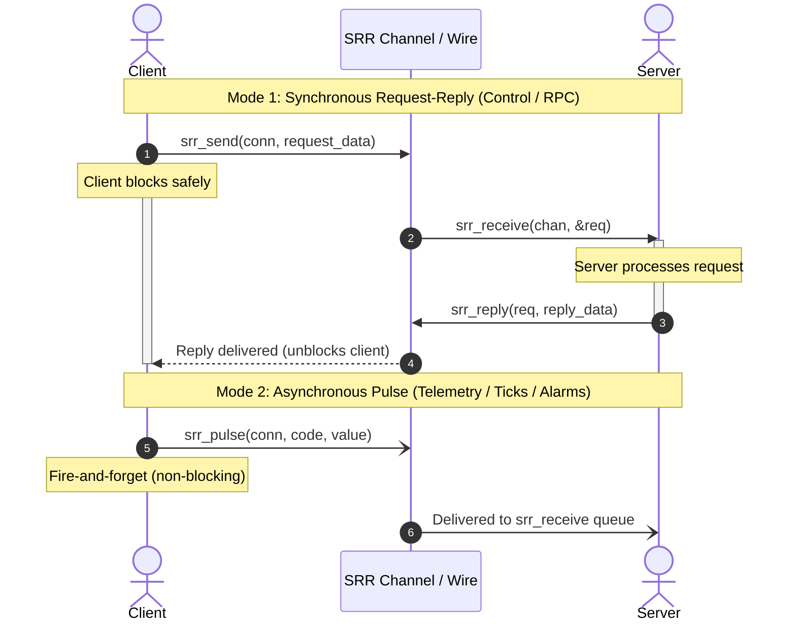

# Getting Started with SRR

This guide walks you through building concurrent, message-driven C applications with **SRR (Send / Receive / Reply)**.

---

## What SRR Is Good For & How to Use It

### Why Use SRR in Your System?
* **One Contract for Polyglot Software & Hardware:** The exact same Send / Receive / Reply code connects high-level host software (Go, Python, Node, Erlang) to C background services and microcontrollers (Pico, AVR, ESP32).
* **Message-Oriented, Never Stream-Oriented:** Delivers discrete, all-or-nothing message packets. You never write partial read loops, track byte counters, or parse delimiters.
* **Immune to the Stale-Reply Trap:** Unlike raw sockets where timed-out requests leave behind stale responses that corrupt future reads, SRR's single-winner state machine automatically discards late replies by transaction ID.
* **Message Passing Without Mutexes:** Like Go channels or Erlang mailboxes, SRR replaces complex mutex lock orchestration with clean, channel-based message passing (`6.7 µs` in-process).
* **Zero-Heap Microcontroller Profiles:** Runs without dynamic heap memory (`malloc`), fitting into as little as 335 bytes of RAM on an 8-bit Arduino.

### The Core Interaction Model



### The Adopter's Mental Model: 3 Core Shifts

1. **Think in Transactions, Not Byte Streams:**
   You never write loops to handle partial reads, track byte counts, search for newline `\n` delimiters, or assemble fragmented TCP/serial streams. You submit an entire message and receive an entire reply. If a timeout occurs, that transaction is permanently dead—it will never pollute future reads.

2. **The Two Interaction Primitives (Send vs. Pulse):**
   * **Need an answer or confirmation?** Use `srr_send()` (Client blocks safely until Server answers). Ideal for RPC commands, parameter updates, and queries.
   * **Fire-and-forget event or telemetry?** Use `srr_pulse()` (Client never blocks, Server never replies). Ideal for 100 Hz sensor ticks, heartbeats, alarms, and GPIO triggers.

3. **Code to Services, Not Physical Cables:**
   Avoid hardcoding `/dev/ttyUSB0` or IP addresses in business logic. Connect to a symbolic service name (`"motor_controller"`). Whether that service lives across a thread pointer, a Unix socket, a UDP network datagram, or an Arduino over USB serial, your application code is identical.

---

### The Golden Rule for Servers: "Always Answer or Dispose"

When a server dequeues a request from `srr_receive(chan, &req)`, the client is suspended waiting for a resolution. The server **must** do one of the following:

* **Success:** `srr_reply(req, reply_data, len)` — delivers response data and unblocks client with `SRR_OK`. Automatically disposes of the request handle.
* **Business Error:** `srr_reply_error(req, SRR_INVALID)` — unblocks client with an explicit error code. Automatically disposes of the request handle.
* **Cancellation / Abandonment:** `srr_request_dispose(req)` — drops the request and safely unblocks the client with `SRR_CANCELLED` (no hanging clients).
* **If it's a Pulse (`srr_request_is_pulse(req)`):** Read `srr_pulse_code()` and `srr_pulse_value()`, then call `srr_request_dispose(req)`. (Never call `srr_reply()` on a pulse).

---

## 1. Quick Tutorial: In-Process Thread Messaging

In SRR, threads communicate through **channels** and **connections** without sockets or network overhead.

### Complete Working Example (`example_threads.c`)

```c
#include <stdio.h>
#include <string.h>
#include <pthread.h>
#include <assert.h>
#include "srr/srr.h"

static void *server_worker(void *arg) {
    srr_channel_t *channel = (srr_channel_t *)arg;
    srr_request_t *req = NULL;

    // Block until requests arrive
    while (srr_receive(channel, &req) == SRR_OK) {
        const char *input = (const char *)srr_request_data(req);

        char reply[128];
        snprintf(reply, sizeof(reply), "PONG: %s", input);

        // Reply to client and unblock client thread
        srr_reply(req, reply, strlen(reply) + 1);
    }
    return NULL;
}

int main(void) {
    // 1. Server creates in-process channel
    srr_channel_t *channel = NULL;
    assert(srr_channel_create(NULL, &channel) == SRR_OK);

    // 2. Start server receiver thread
    pthread_t server_th;
    pthread_create(&server_th, NULL, server_worker, channel);

    // 3. Client connects directly to in-process channel
    srr_connection_t *conn = NULL;
    assert(srr_connect_channel(channel, NULL, &conn) == SRR_OK);

    // 4. Client issues synchronous send
    const char *msg = "ping!";
    char reply[128] = {0};
    size_t reply_sz = 0;

    srr_status_t status = srr_send(conn, msg, strlen(msg) + 1, reply, sizeof(reply), &reply_sz);
    if (status == SRR_OK) {
        printf("Client received: %s\n", reply);
    }

    // 5. Cleanup
    srr_disconnect(conn);
    srr_channel_close(channel);
    pthread_join(server_th, NULL);
    srr_channel_destroy(channel);
    return 0;
}
```

### Compiling and Running
```bash
gcc -Wall -Wextra -pthread -Iinclude example_threads.c -L. -lsrr -o example_threads
./example_threads
```

---

## 2. Moving Across Process Boundaries (Zero Code Changes!)

To make the exact same service communicate across distinct OS processes:

### Server Process
Change channel creation to specify a service name:
```c
srr_channel_create_service("echo_service", NULL, &channel);
```

### Client Process
Change client connection to specify the service name:
```c
srr_connect("echo_service", NULL, &conn);
```

**That is the only change.**
The request processing, message payload handling, timeout semantics, and reply logic remain 100% identical.

---

## 3. Idiomatic Payload Design: Structs, Unions & Zero-Copy Dispatch

A frequent question from developers adopting SRR is:
> *"Does SRR enforce a payload schema (like Protobuf or JSON)? How did real-world QNX applications structure messages in practice?"*

Like the QNX microkernel, SRR treats message payloads as **opaque byte buffers (`const void *`)**. This gives you complete freedom to transmit anything from JSON strings to raw binary sensor frames.

However, **safety-critical and real-time systems established a classic, battle-tested pattern** that avoids dynamic memory allocation (`malloc`), eliminates parsing overhead, and guarantees compile-time type safety: **The QNX-style Struct and Union Pattern**.

### The Pattern in 4 Steps:
1. **Define typed C structs** for every request and reply, using fixed-width integer and float types (`<stdint.h>`).
2. **Include a leading message discriminator** (`uint16_t type` / opcode) as the first field of each request struct.
3. **Define a `union`** of all possible incoming request structs on the server.
4. **Dispatch with a `switch` statement** directly from the incoming buffer: **zero `malloc`, zero serialization parsing, and zero copy**.

#### 1. Defining the Message Schema (`messages.h`)
```c
#include <stdint.h>

// 1. Message Type Discriminators (Opcodes)
typedef enum {
    MSG_CMD_SET_SPEED     = 0x0101,
    MSG_CMD_GET_TELEMETRY = 0x0102,
    MSG_CMD_EMERGENCY_STOP= 0x0103,
} msg_type_t;

// 2. Request Payloads (leading field MUST match msg_type_t)
typedef struct {
    uint16_t type;          // MSG_CMD_SET_SPEED
    uint16_t motor_index;
    float    target_rpm;
} req_set_speed_t;

typedef struct {
    uint16_t type;          // MSG_CMD_GET_TELEMETRY
    uint16_t motor_index;
} req_get_telemetry_t;

typedef struct {
    uint16_t type;          // MSG_CMD_EMERGENCY_STOP
} req_emergency_stop_t;

// 3. Server Request Union (calculates the maximum request size at compile time)
typedef union {
    uint16_t             type;
    req_set_speed_t      set_speed;
    req_get_telemetry_t  get_telemetry;
    req_emergency_stop_t estop;
} server_msg_union_t;

// 4. Reply Payloads
typedef struct {
    int32_t  status_code;   // 0 = OK, negative = error
} reply_ack_t;

typedef struct {
    int32_t  status_code;
    float    current_rpm;
    float    temperature_c;
    uint32_t fault_flags;
} reply_telemetry_t;
```

#### 2. Server Implementation: Zero-Copy Switch Dispatch
```c
void run_motor_server(srr_channel_t *channel) {
    srr_request_t *req = NULL;

    while (srr_receive(channel, &req) == SRR_OK) {
        if (srr_request_is_pulse(req)) {
            // One-way non-blocking pulses: dispose and continue
            srr_request_dispose(req);
            continue;
        }

        const uint8_t *data = (const uint8_t *)srr_request_data(req);
        size_t size = srr_request_size(req);

        // Sanity check: must contain at least the opcode header
        if (size < sizeof(uint16_t)) {
            reply_ack_t err = { .status_code = -1 };
            srr_reply(req, &err, sizeof(err));
            continue;
        }

        // Direct zero-copy overlay: cast payload directly to the union
        const server_msg_union_t *msg = (const server_msg_union_t *)data;

        switch (msg->type) {
        case MSG_CMD_SET_SPEED:
            if (size >= sizeof(req_set_speed_t)) {
                apply_motor_speed(msg->set_speed.motor_index, msg->set_speed.target_rpm);
                reply_ack_t ack = { .status_code = 0 };
                srr_reply(req, &ack, sizeof(ack));
            }
            break;

        case MSG_CMD_GET_TELEMETRY:
            if (size >= sizeof(req_get_telemetry_t)) {
                reply_telemetry_t telem = {
                    .status_code = 0,
                    .current_rpm = read_motor_rpm(msg->get_telemetry.motor_index),
                    .temperature_c = read_motor_temp(msg->get_telemetry.motor_index),
                    .fault_flags = 0
                };
                srr_reply(req, &telem, sizeof(telem));
            }
            break;

        case MSG_CMD_EMERGENCY_STOP:
            trigger_hard_stop();
            reply_ack_t ack = { .status_code = 0 };
            srr_reply(req, &ack, sizeof(ack));
            break;

        default: {
            reply_ack_t err = { .status_code = -2 }; // Unknown opcode
            srr_reply(req, &err, sizeof(err));
            break;
        }
        }
    }
}
```

#### 3. Client Implementation: Fully Type-Safe Call
```c
// Client sends a typed struct and receives a typed reply directly on the stack
req_set_speed_t cmd = {
    .type = MSG_CMD_SET_SPEED,
    .motor_index = 0,
    .target_rpm = 1500.0f
};
reply_ack_t reply = {0};
size_t reply_len = 0;

srr_status_t rc = srr_send(conn, &cmd, sizeof(cmd), &reply, sizeof(reply), &reply_len);
if (rc == SRR_OK && reply.status_code == 0) {
    printf("Motor speed updated successfully.\n");
}
```

### Alternative: Using Built-in `service_id` & `operation_id` (Embedded Tier)
When using SRR over physical wire transports (`srr_embedded.h`), the 32-byte SRR wire frame header **already includes** `service_id` (16-bit) and `operation_id` (16-bit). In this tier:
* `service_id` identifies the target subsystem (e.g., `0x0010 = MotorController`).
* `operation_id` identifies the command (e.g., `0x0001 = SetSpeed`).
* The payload simply contains `struct { uint16_t motor_index; float target_rpm; }` without needing a leading `type` tag.
* The server's `srr_service_handler_t` receives `operation_id` directly as a parameter and casts the payload directly to the command struct.

> [!TIP]
> **Why this matters for embedded & safety-critical systems:**
> By avoiding text-based parsers (JSON, XML) and dynamic serialization engines, message dispatch is completely deterministic ($O(1)$ constant time) and causes **zero heap fragmentation**.

---

## 4. Handling Timeouts & Deadlines

Use `srr_send_timed()` to enforce maximum wait times:

```c
// Timeout after 250 milliseconds
srr_status_t status = srr_send_timed(
    conn,
    request_data, request_len,
    reply_buf, sizeof(reply_buf),
    &reply_size,
    250
);

if (status == SRR_TIMEOUT) {
    printf("Server did not reply within 250ms\n");
}
```

---

## 5. One-Way Pulses (Heartbeats / Event Ticks)

For lightweight, non-blocking notifications that require no reply:

### Client
```c
// Send a pulse with 32-bit code (e.g. 1 = CLOCK_TICK) and 64-bit value
srr_pulse(conn, 1, 100);
```

### Server
```c
srr_request_t *item = NULL;
if (srr_receive(channel, &item) == SRR_OK) {
    if (srr_request_is_pulse(item)) {
        uint32_t code = srr_pulse_code(item);
        uint64_t val = srr_pulse_value(item);
        printf("Received pulse: code=%u, value=%lu\n", code, (unsigned long)val);

        // Always dispose pulses (do not call srr_reply!)
        srr_request_dispose(item);
        continue;
    }
}
```

---

## 6. Using the Language Adapters

### Erlang/OTP
```erlang
{ok, Client} = srr_client:start_link("echo_service").
{ok, Reply} = srr_client:call(Client, <<"hello">>).
ok = srr_client:pulse(Client, 1, 42).
srr_client:stop(Client).
```

### Elixir
```elixir
{:ok, client} = SRR.start_link("echo_service")
{:ok, reply} = SRR.call(client, "hello")
:ok = SRR.pulse(client, 1, 42)
SRR.stop(client)
```

### Web Browser (WebSocket Gateway)
Run the gateway:
```bash
python3 gateway/web_gateway.py
```
Send JSON commands from JavaScript:
```javascript
const ws = new WebSocket("ws://127.0.0.1:8081");
ws.onopen = () => {
  ws.send(JSON.stringify({ action: "send", cmd: "STATUS" }));
};
ws.onmessage = (event) => {
  const res = JSON.parse(event.data);
  console.log("SRR reply:", res.reply);
};
```
