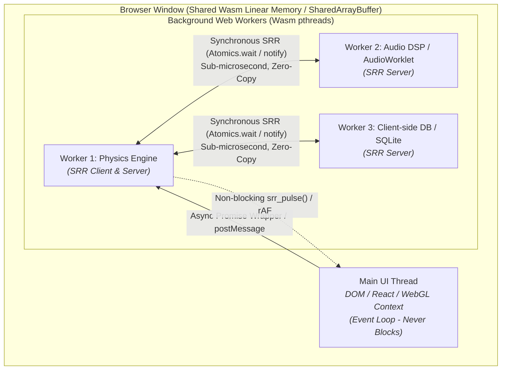

# In-Browser High-Performance IPC: SRR over WebAssembly and Web Workers

This document examines how the **Send-Receive-Reply (SRR)** messaging pattern operates inside modern web browsers using **WebAssembly (Wasm)**, **Web Workers**, and **`SharedArrayBuffer`**, and evaluates its relative efficiency compared to contemporary browser communication mechanisms (`postMessage`, `Comlink`, Transferables, and Web Streams).

---

## 1. Architectural Overview

Modern web applications (in-browser IDEs, CAD tools, WebGPU game engines, digital audio workstations, and local AI/LLM runtimes) increasingly offload heavy computations to background **Web Workers** and **AudioWorklets**.

However, communicating between these execution threads inside the browser has historically been constrained by JavaScript's single-threaded event loop and asynchronous messaging models.

By compiling SRR's core C engine to WebAssembly using Emscripten's POSIX Threads (`-pthread`) support:
1. **Background Web Workers communicate peer-to-peer** using standard synchronous `srr_send()`, `srr_receive()`, and `srr_reply()` calls.
2. **Data resides in a single, unified `SharedArrayBuffer`** representing Wasm's linear memory.
3. **Synchronization is handled directly by hardware CPU atomics** (`Atomics.wait` and `Atomics.notify`), bypassing the browser's JavaScript event loop and garbage collector.
4. **The Main UI thread interacts with the worker cluster** via an asynchronous Promise facade or non-blocking pulses (`srr_pulse`), ensuring that DOM rendering and user input at 60/120 Hz remain silky smooth.



---

## 2. The Contemporary Landscape: How Browsers Do IPC Today

To understand the efficiency gains of SRR in Wasm, we must analyze the existing communication primitives available in web browsers today:

### 1. `postMessage()` with Structured Cloning (The Universal Default)
* **Mechanism:** The sender passes a JavaScript object to `worker.postMessage(data)`. The browser executes the **Structured Clone Algorithm**, deep-copying the entire object graph into an intermediate internal representation, dispatching a task to the recipient's event loop, and re-allocating new objects on the recipient's V8/SpiderMonkey heap.
* **Limitations:**
  * **Serialization Overhead:** Deep-copying nested objects, strings, and typed arrays consumes significant CPU time.
  * **Garbage Collection (GC) Thrashing:** Creating thousands of temporary cloned objects per second triggers frequent V8 GC pauses, causing dropped frames (jank) in real-time graphics and audio buffer underruns.
  * **Event Loop Jitter:** Messages sit in the recipient's macro-task event queue behind other queued callbacks. Round-trip latency varies from 0.5 ms to 15+ ms depending on workload.
  * **No Backpressure:** If the caller posts 10,000 messages faster than the worker can process them, memory balloons uncontrollably until the tab crashes.

### 2. `postMessage()` with Transferable Objects (`ArrayBuffer.transfer`)
* **Mechanism:** Rather than copying memory, the browser transfers *ownership* of the underlying memory pointer to the recipient worker.
* **Limitations:**
  * **Destructive:** Once transferred, the sender's local buffer is detached (`byteLength` immediately becomes `0`). The sender can no longer read or write to that buffer.
  * **Asymmetric:** Transferring data back requires another round of ownership transfer.
  * **Still Asynchronous:** Transfers must still be queued and processed through the browser's macro-task event loop.

### 3. Comlink (Google Chrome Labs) & RPC Wrappers
* **Mechanism:** Comlink wraps `postMessage` in JavaScript `Proxy` objects, allowing developers to call `await worker.someFunction(arg)`.
* **Limitations:** While Comlink provides an ergonomic RPC syntax, **it does not change the physical transport**. Every call still serializes arguments through structured cloning and creates transient Promise/closure allocations, compounding GC pressure in tight loops.

### 4. Custom `SharedArrayBuffer` Ring Buffers
* **Mechanism:** Advanced developers allocate a shared memory buffer and build custom circular queues (ring buffers) using `Atomics.load()` and `Atomics.store()`.
* **Limitations:** While fast, custom ring buffers lack structured request-reply transaction semantics, timeout guarantees, error codes, and thread isolation. Developers frequently suffer from race conditions, missed wakeups, and lack of channel multiplexing.

---

## 3. The Wasm + SRR Advantage: Relative Efficiency Comparison

SRR operating over WebAssembly `SharedArrayBuffer` fundamentally changes the performance profile of browser IPC:

| Metric / Dimension | `postMessage()` (Structured Clone) | Comlink (RPC Abstraction) | Transferable `ArrayBuffer` | **SRR over Wasm (`SharedArrayBuffer`)** |
| :--- | :--- | :--- | :--- | :--- |
| **Data Copying** | Deep copy (two copies + graph traversal) | Deep copy + Proxy serialization | Zero-copy (ownership transferred) | **True Zero-Copy** (Direct pointer/offset overlay) |
| **Memory Allocation** | Allocates on JS heap (Sender + Receiver) | Allocates Promises + cloned objects | Allocates metadata | **Zero JS Heap Allocation** (Static Wasm linear memory) |
| **Garbage Collector Impact** | **Severe** (continuous GC churn) | **Severe** (continuous GC churn) | Low | **Zero GC Overhead** (C memory is unmanaged by V8) |
| **Round-Trip Latency** | 500 µs – 10,000 µs (0.5 ms – 10 ms) | 600 µs – 12,000 µs | 300 µs – 2,000 µs | **< 1 µs – 5 µs** (Sub-microsecond CPU futex) |
| **Scheduling Jitter** | High (depends on browser event loop queue) | High (event loop + microtask queue) | Moderate | **Near-Zero** (Direct OS-level thread wakeup) |
| **Backpressure** | None (queues unbounded memory) | None (unbounded Promise chains) | None | **Hardware-Level Backpressure** (Caller blocks on reply) |
| **Concurrency Flow** | Asynchronous callback / Promise | Asynchronous `await` | Asynchronous callback | **Synchronous RPC** (Worker-to-Worker) + **Async Facade** (UI) |

---

## 4. Why SRR Outperforms Contemporary Approaches

### 1. Nanosecond Futexes vs. Millisecond Event Loops
In standard browser messaging, when Worker A calls `workerB.postMessage()`, the browser puts a task on Worker B's event loop. Worker B must finish whatever JavaScript function it is executing, return to the event loop, pick up the message, unpack it, and run the callback.

With SRR in Wasm:
* Worker B executes `srr_receive()`. If no request is pending, it executes `Atomics.wait()`, suspending the thread at the kernel/OS level.
* Worker A calls `srr_send()`. It writes the 32-byte header and payload directly into shared linear memory and executes `Atomics.notify()`.
* The CPU wakes Worker B immediately. The round-trip time is measured in **microseconds**, not milliseconds.

### 2. Elimination of Garbage Collection Jank
In performance-sensitive browser workloads (like WebAudio synthesisers, WebGL/WebGPU games, or client-side SQLite engines), GC pauses are the primary cause of stutter:
* A `postMessage` pipeline exchanging 2,000 messages per second (e.g., telemetry, sensor events, or audio parameter updates) creates tens of thousands of short-lived V8 heap allocations per second.
* Eventually, the browser is forced to pause execution for a **Major Mark-Sweep GC cycle (10 ms – 50 ms)**, causing audio crackling and dropped animation frames.
* SRR operates strictly within pre-allocated Wasm linear memory. **Not a single byte of JavaScript heap memory is allocated or freed during an SRR transaction.**

### 3. Native Flow Control (The "Stale Reply" & Flooding Prevention)
In standard browser architectures, if Worker A sends data faster than Worker B can process it, Worker B's event loop queue accumulates millions of unhandled messages, resulting in tab out-of-memory crashes.

With SRR:
* `srr_send()` places Worker A into a blocked state until Worker B explicitly evaluates the request and issues `srr_reply()`.
* It is **physically impossible for a fast client worker to overwhelm a slow server worker**, because the client cannot issue a second request until the first has been acknowledged.

---

## 5. Handling the Browser's One Rule: The Main UI Thread

There is one critical constraint in the W3C Web standards:
> **`Atomics.wait()` is forbidden on the Main UI Thread.**
> Calling `Atomics.wait()` on the main thread throws a JavaScript `TypeError: Atomics.wait cannot be called on the main thread`. This prevents developers from freezing the browser window, DOM rendering, and user scrolling.

Because of this rule, SRR topologies in the browser naturally split into two zones:

### Zone 1: The Background Worker Mesh (Synchronous)
Between distinct background Web Workers (Worker 1 $\leftrightarrow$ Worker 2 $\leftrightarrow$ Worker 3):
* Both workers are background OS threads.
* Both can block freely with `Atomics.wait()`.
* They use pure, standard synchronous SRR (`srr_send`, `srr_receive`, `srr_reply`).

### Zone 2: The Main UI Interface (Asynchronous & Reactive)
When the Main UI thread interacts with the worker cluster:
1. **UI as Client (Async Promise Facade):**
   A small JavaScript helper exposes an async wrapper:
   ```javascript
   // In Main UI Thread
   const reply = await srrClient.send("physics_service", { cmd: "GET_BODY_TRANSFORM", id: 42 });
   ```
   Under the hood, this posts a lightweight descriptor to a dedicated proxy worker or uses non-blocking polling during `requestAnimationFrame`.
2. **Worker to UI as Telemetry (Non-Blocking Pulses):**
   When a background worker has high-frequency state updates (e.g. 60 Hz visual telemetry, audio meter levels), it emits an `srr_pulse()`. The pulse is read by the UI thread non-blockingly during its normal render tick, updating UI state without stalling the worker's computation.

---

## 6. Real-World Browser Use Cases

1. **Digital Audio Workstations (DAW) & WebAudio:**
   * **Worker 1 (AudioWorklet):** Real-time DSP engine executing in an audio render thread.
   * **Worker 2 (SoundFont / Sampler Engine):** Loads multi-megabyte audio sample tables from IndexedDB into Wasm shared memory.
   * **Interaction:** The AudioWorklet uses SRR to request sample slices synchronously without jitter or dynamic memory allocation.
2. **WebGPU Game Engines & Physics Simulation:**
   * **Worker 1 (Physics):** Runs Havok or Bullet compiled to Wasm.
   * **Worker 2 (Game AI / Scene Graph):** Computes NPC paths and collision responses.
   * **Interaction:** The AI engine queries raycasts and transform matrices from the physics worker in sub-microsecond synchronous calls.
3. **In-Browser Analytical Databases (DuckDB / SQLite Wasm):**
   * **Worker 1 (Query Planner / Worker):** Executes complex SQL queries across gigabyte-sized Parquet files.
   * **Worker 2 (Visualization / Charting Worker):** Computes aggregation buckets.
   * **Interaction:** Data queries run via zero-copy union overlays directly in shared Wasm memory.

---

## 7. Conclusion

Bringing the QNX-style Send-Receive-Reply pattern to WebAssembly and Web Workers bridges the gap between native systems performance and the web platform:

* **Worker-to-Worker communication** reaches near-native speeds (< 5 µs round-trips), escaping the latency, jitter, and memory copying of `postMessage()`.
* **Zero Garbage Collection** eliminates UI stutter and audio crackle in compute-heavy browser applications.
* **Deterministic Backpressure** guarantees system stability under high computational loads.
